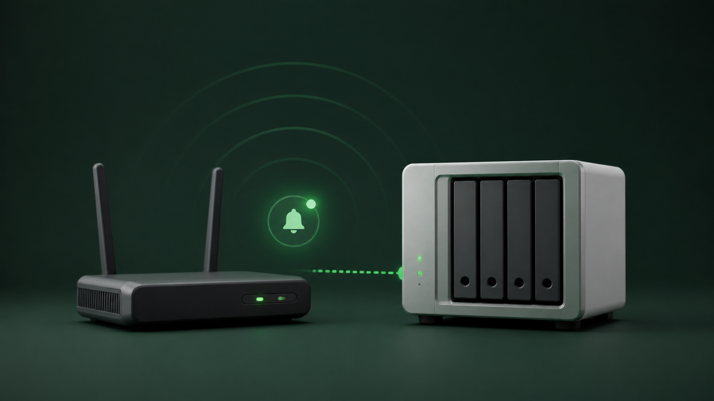

# EasyNotice

把 NAS、软路由和 Docker 应用各说各话的通知，统一收进 EasyNotice，再按你的习惯送到企业微信、Telegram 或 Bark。



通知不该要求用户先学会 Webhook、JSON 和请求头。EasyNotice 的目标很直接：**原应用只负责把事情告诉 EasyNotice，EasyNotice 负责识别内容、选择渠道、失败补位，并留下可查的记录。**

## 先理解一件事

一条通知只有三段路：

```text
Lucky / OpenWrt / 影视应用 / 监控工具
                    ↓
          EasyNotice 通知入口
        识别内容 → 套用规则 → 选择路线
                    ↓
       企微应用 / 企微机器人 / Telegram / Bark
```

- **通知入口**：每个应用都有自己的收件地址和接入说明。
- **通知出口**：你真正接收消息的渠道。
- **路线**：指定某个入口要发往哪些出口，是逐个补位，还是全部发送。
- **内容规则**：按通知类型改标题、正文、图片和链接。

EasyNotice 不会主动猜测其他应用里发生了什么。原应用至少需要支持自定义 Webhook、HTTP 回调或可填写的请求地址；如果它只允许填写某家通知服务的专用 Key、完全不能自定义 URL，就不能直接接入。

## 它解决什么

| 以前的麻烦 | EasyNotice 的做法 |
| --- | --- |
| 每个应用的 Webhook 填法不同 | 为 Lucky、OpenWrt PushBot、MDC-NG 等生成可直接复制的专用配置 |
| 不知道 JSON 里的标题、正文在哪里 | 自动识别常见字段，也可用规则精确调整 |
| 企业微信应用因可信 IP 变化而失败 | 按顺序自动尝试企微机器人、Telegram 等备用渠道 |
| 同一种应用的不同事件难以分辨 | 按事件类型设置不同标题、正文、图片和点击链接 |
| Webhook 显示成功，却不知道消息去了哪里 | 记录每个出口的尝试次数、耗时、响应和失败原因 |
| 配置术语太多 | 页面按“选择应用 → 复制配置 → 发送测试”的顺序引导 |

当前支持：

- 入口预设：通用 Webhook、Lucky、OpenWrt 全能推送 / PushBot、影视库中枢、影音与刮削、Uptime Kuma、Watchtower / Shoutrrr。
- 通知出口：企业微信应用、企业微信群机器人、Telegram Bot、Bark。
- 路由：失败后按顺序补位，或所有出口都发送。
- 内容：字段自动识别、条件规则、安全模板、图片素材库。
- 排查：通知记录、脱敏原始数据、逐次投递详情和重新发送。
- 可选 AI 助手：根据项目名、说明或截图推荐现有入口预设；它只给建议，不会替你修改其他应用。

## 5 分钟部署

### Docker Compose

在 NAS 上新建一个目录，保存下面的 `docker-compose.yml`：

```yaml
services:
  easynotice:
    image: ghcr.io/xudong7587/easynotice:latest
    container_name: easynotice
    restart: unless-stopped
    ports:
      - "18088:18088"
    environment:
      TZ: Asia/Shanghai
      HOST: 0.0.0.0
      PORT: 18088
    volumes:
      - ./data:/app/data
    healthcheck:
      test: ["CMD", "node", "-e", "fetch('http://127.0.0.1:18088/health').then(r=>{if(!r.ok)process.exit(1)}).catch(()=>process.exit(1))"]
      interval: 30s
      timeout: 5s
      retries: 3
      start_period: 15s
```

然后启动：

```bash
docker compose up -d
```

浏览器访问：

```text
http://NAS的局域网IP:18088
```

例如 NAS 地址是 `192.168.11.239`，就打开 `http://192.168.11.239:18088`。

> `127.0.0.1` 和 `localhost` 只代表“当前这台设备或当前这个容器”。其他电脑、软路由和 Docker 容器接入 EasyNotice 时，不要填写它们；应使用那些设备真正能访问到的 NAS 局域网地址、Docker 服务名或反向代理域名。

使用群晖、绿联、飞牛、威联通等 NAS 的图形界面时，填写同一个镜像、端口、环境变量和数据目录即可。更详细的图形界面说明见[完整使用手册](./docs/使用手册.md)。

## 收到第一条通知

1. **完成首次设置**：创建至少 8 位管理密码；“其他容器访问地址”填写来源设备真正能访问的地址。
2. **添加通知出口**：想最快跑通，先选企业微信群机器人或 Bark；成功后再添加企业微信应用、Telegram 和备用路线。
3. **添加通知入口**：选择 Lucky、OpenWrt 等预设；不确定时选“通用 Webhook”。
4. **复制到原应用**：EasyNotice 会给出地址、请求方式、请求体，或像 OpenWrt PushBot 那样给出必须整段粘贴的配置。
5. **发送测试并看记录**：原应用提示 Webhook 成功只代表 EasyNotice 已收到；最终是否送达，以“通知记录”里的出口详情为准。

## 出口怎么选

| 渠道 | 适合什么 | 图片表现 | 需要注意 |
| --- | --- | --- | --- |
| 企业微信应用 | 主要通知渠道，需要图文和点击链接 | 本地图片或公网图片可生成图文 | 企业微信要求配置可信公网 IP |
| 企业微信群机器人 | 最容易配置，也适合给企微应用补位 | 固定发送纯文字 | 填机器人 Webhook 中 `key=` 后的内容即可 |
| Telegram Bot | 需要清晰的文字或大图通知 | 本地图片可直接上传，公网图片可直接发送 | 当前不会附加规则中的点击链接 |
| Bark | iPhone 个人推送 | 图片作为通知图标 | 图片地址必须能被 Bark 服务端从公网访问 |

推荐的企业微信主备路线：

```text
企业微信应用（顺位 1）
        ↓ 失败时
企业微信群机器人（顺位 2，纯文字）
        ↓ 仍失败时
Telegram Bot（顺位 3，可选）
```

每个出口最多尝试两次。补位模式中，一旦某个出口成功，后面的出口就会跳过；“所有出口都发送”模式则会逐个尝试全部已勾选出口。

## 哪些应用接入最省事

| 应用或场景 | EasyNotice 提供的帮助 |
| --- | --- |
| Lucky | 按 DDNS、公网 IP、STUN、设备上下线、计划任务等场景生成请求体 |
| OpenWrt 全能推送 / PushBot | 生成一整段配置，直接覆盖粘贴到“自定义推送”大文本框 |
| MoviePilot 等影视库工具 | 给出 WebHook 插件接法；其他工具需确认当前版本支持自定义 URL |
| MDC-NG、Emby、Jellyfin、Plex | 提供常见 Endpoint、POST、请求头和 JSON 示例 |
| Uptime Kuma | 使用通知里的 Webhook 类型接入 |
| Watchtower / Shoutrrr | 提供通用 Webhook 接法 |
| 其他应用 | 通用入口可接收 JSON、表单、纯文本、XML 文本和 URL 查询参数 |

OpenWrt PushBot 是一个特殊情况：它的页面没有单独的 URL 输入框，因此不要把通用 Webhook 的地址、请求头、请求体分开填写。进入 EasyNotice 的 OpenWrt 入口后，复制生成的**整段配置**，粘贴到 PushBot 的“自定义推送”大文本框并保存。

## 图片和预览不会偷偷替换真实内容

- 出口卡片上的“预览”只测试单一渠道，不生成通知记录。
- 入口详情里的“整链路测试预览”会真正进入队列，经过规则和路线，并出现在通知记录中。
- 测试预览在没有图片时会使用项目内置封面，便于确认图文能力。
- 真实 Webhook 只有在原应用提供图片，或内容规则指定图片时才会带图；EasyNotice 不会把默认测试封面塞进真实通知。
- 企业微信群机器人始终是纯文字，即使入口里有图片也不会跳转到默认封面。

## 数据一定要保存

所有配置、通知记录、加密密钥和上传图片都位于挂载的 `./data` 目录。请定期备份**整个目录**，不要只复制数据库文件，也不要遗漏 `.installation-secret`。

推荐先停容器再备份：

```bash
docker compose stop easynotice
sudo tar -czf easynotice-data-backup.tar.gz data
docker compose start easynotice
```

以上命令适用于官方 `./data:/app/data` 目录挂载，并应由能读取该目录的管理员执行。不要为了处理权限问题使用 `chmod -R 777`。镜像最终以 UID `1000` 运行，启动脚本还需要能调整目录所有权；NFS/SMB 常因 root-squash、ACL 和 SQLite 文件锁出现问题，优先使用 NAS 本地文件系统。命名卷和外置主密钥另有备份步骤，见[使用手册的运维章节](./docs/使用手册.md#更新备份与恢复)。

## 更新

使用 `latest` 时：

```bash
docker compose pull
docker compose up -d --force-recreate
```

只执行 `restart` 不会下载新镜像。需要长期固定版本时，把镜像标签改成 [Releases](https://github.com/xudong7587/easynotice/releases/latest) 中的某个 `vX.Y.Z`，并在更新前备份数据。

## 常见问题

### 反向代理能打开，局域网 IP 却打不开

确认端口映射是 `18088:18088`、`HOST=0.0.0.0`，再检查 NAS 防火墙、网卡绑定、VLAN、访客网络和 AP 隔离。反向代理成功并不能证明局域网到 NAS 的 18088 端口已经放行。

### 容器反复重启，日志显示不能创建 `/app/data/uploads`

先拉取最新镜像并重建容器。如果仍报 `EACCES`，检查挂载目录是否允许 UID `1000` 创建文件；不要把只读共享目录直接挂到 `/app/data`。

### 企业微信应用报错 `60020`

企业微信拒绝了当前公网出口 IP。把错误里显示的 IP 加入企业可信 IP，或让该入口在失败后尝试企微群机器人。

### Webhook 返回成功，但手机没收到

Webhook 的成功响应表示通知已经进入 EasyNotice。打开“通知记录”，查看是否没有勾选出口、规则是否匹配，以及每个出口两次尝试的错误信息。

### 为什么测试有图，真实通知没有图

默认封面只用于测试预览。请让原应用传入 `image`、`poster`、`thumb`、`cover` 等图片字段，或在内容规则中选择素材。

更多问题见[完整使用手册](./docs/使用手册.md#排查问题)。

## 安全说明

- 管理密码使用 bcrypt 保存；登录失败有频率限制。
- 渠道密钥、AI Key、入口原始内容等敏感数据使用 AES-256-GCM 加密保存。
- Webhook 原始内容会对常见密码、Token、Cookie 字段脱敏后入库。
- 每个入口地址本身就是凭证，不要发布到公开截图或日志；更换入口密钥后，旧地址立即失效。
- 通知标题和正文用于搜索，会保存在数据库中；不要把密码或完整 Token 当作通知内容发送。
- 若通过 HTTPS 反向代理访问，建议设置 `EASYNOTICE_COOKIE_SECURE=true`。

## 继续阅读

- [完整使用手册：从首次设置到逐项排障](./docs/使用手册.md)
- [最新版本与更新说明](https://github.com/xudong7587/easynotice/releases/latest)
- [容器镜像](https://github.com/xudong7587/easynotice/pkgs/container/easynotice)
- [问题反馈](https://github.com/xudong7587/easynotice/issues)

EasyNotice 仍在持续完善。如果某个 NAS 应用只有你见过的特殊配置页面，提交项目名和打码后的截图，会比只说“Webhook 接不上”更容易把它做成真正可复制的入口预设。
